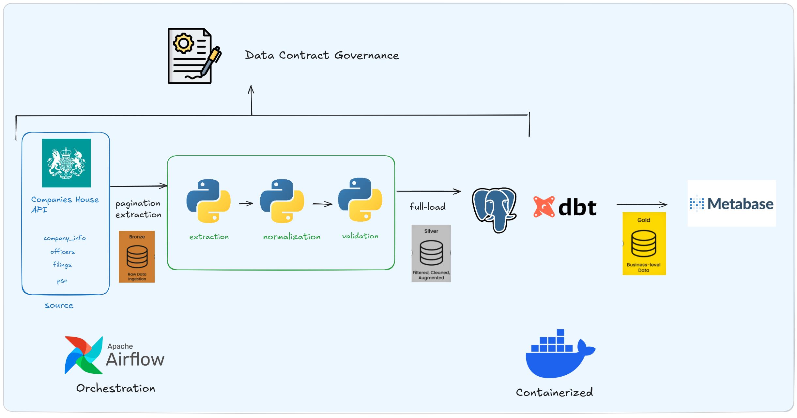

# Companies House Pipeline

This project turns public Companies House records into a clearer picture of how four companies are run and how they change over time. It brings together company profiles, officer appointments, filing history, and persons with significant control (PSCs) to answer practical questions: which deadlines need attention, how boards have changed, who holds control, and what companies have filed or declared in capital.

The pipeline takes the data from the API through Python processing and PostgreSQL storage to dbt models and Metabase visualizations. The aim is to make those records easier to explore while keeping the detail needed to understand each result.

## Companies covered

The project follows these four companies, identified by their Companies House numbers in the [data contract](data/contract.yml):

| Company | Company number |
| --- | --- |
| Wild | `11740984` |
| Fussy | `12462889` |
| AKT London | `11211232` |
| The Natural Deodorant Co | `09505635` |

## How the pipeline works



The data moves through three layers: **bronze** for raw JSON, **silver** for normalized and validated tables, and **gold** for analytical models.

1. **Extract from the API.** Python retrieves each company profile and its officers, filings, and PSC records. Collection endpoints are paginated: the extractor advances through the pages until it reaches the reported total or receives an empty page. The collected responses are saved as JSON.

2. **Normalize and validate.** Nested records are split into CSV tables. A YAML data contract defines the expected structure and quality thresholds. Validation checks columns, completeness, and uniqueness; critical failures stop the load.

3. **Load PostgreSQL.** Each run performs a full refresh of the staging tables, replacing their contents with the validated dataset. PostgreSQL’s `COPY` command loads the CSV files, with the refresh handled in one transaction.

4. **Build the analytical models.** dbt transforms staging data into facts, dimensions, and five marts covering obligations, governance, control, filing activity, and capital history. It also retains company and PSC observations across build dates and runs tests on the models.

5. **Explore in Metabase.** Charts and tables turn the marts into deadline queues, board timelines, control summaries, filing trends, and capital comparisons. Comparison rules flag capital declarations that cannot be compared reliably.

Airflow runs extraction, normalization, validation, loading, and the dbt build in order, on a monthly schedule once the DAG is enabled. Docker Compose brings together Airflow, PostgreSQL, and Metabase.

## Explore the results

- [Analytics marts](docs/marts/MARTS.md): the questions each view answers, its row grain, and Metabase examples.
- [Star schemas](docs/stars/STARS.md): the detailed models behind the marts, with diagrams and key interpretation notes.

## How to run

You’ll need Docker with Docker Compose and a Companies House API key. Run the commands from the repository root.

1. Copy `.env.example` to `.env` and fill in `API_KEY`, `POSTGRES_PASSWORD`, and `METABASE_DB_PASSWORD`. On Linux or WSL, set `AIRFLOW_UID` to the output of `id -u`.

2. Build and start the services:

   ```bash
   docker compose up -d --build
   ```

3. Once Airflow is ready, open [localhost:8080](http://localhost:8080) and sign in as `admin`. In another terminal use this to retrieve its generated password:

   ```bash
   docker compose exec airflow cat /opt/airflow/logs/simple_auth_manager_passwords.json
   ```

   Enable the `housing_pipeline` DAG and trigger a run. It executes all five stages, ending with the dbt build and tests; future runs follow the monthly schedule.

4. After the run succeeds, open [Metabase at localhost:3000](http://localhost:3000) and complete its setup. Add a PostgreSQL connection using host `db`, port `5432`, and the warehouse database name, username, and password from `.env`. Explore the marts in the `gold` schema to create your own questions and charts. The screenshots in the docs are examples, not automatically installed dashboards.

To stop the services while keeping the stored data:

```bash
docker compose down
```

