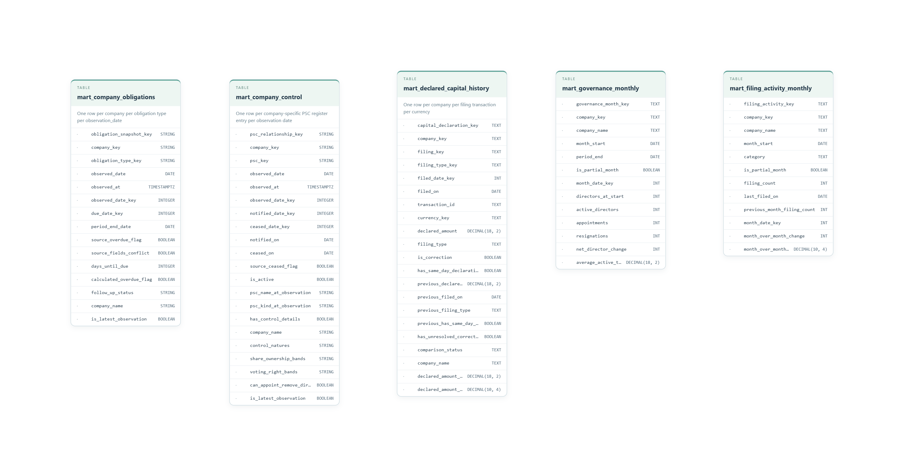
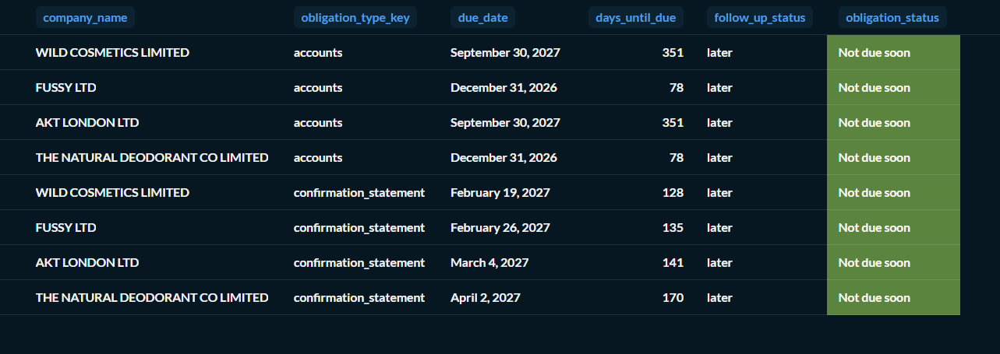
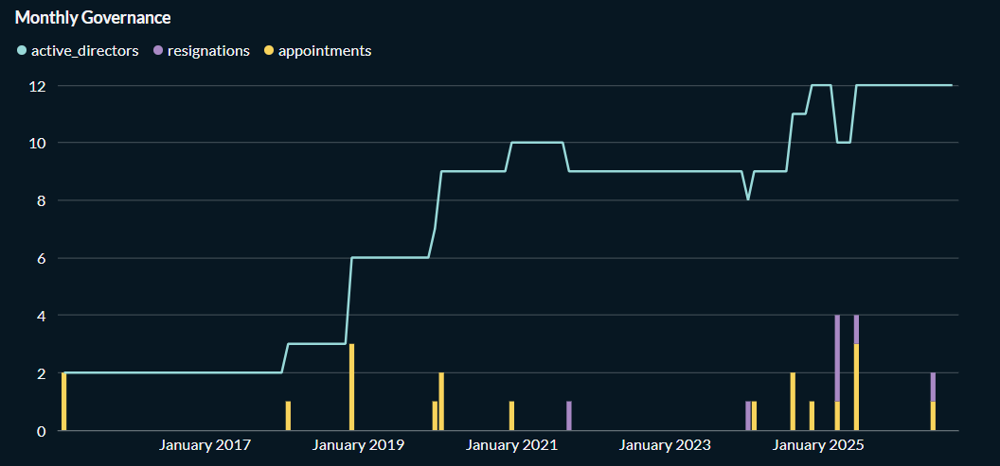
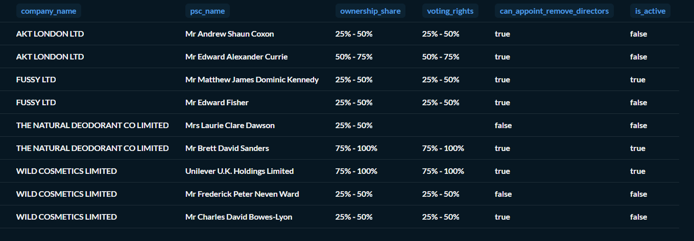
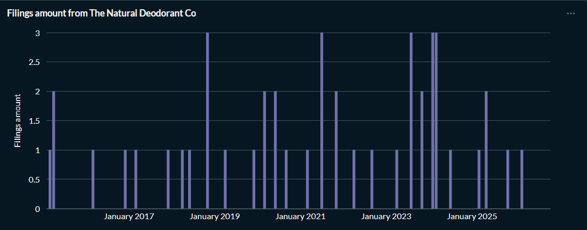
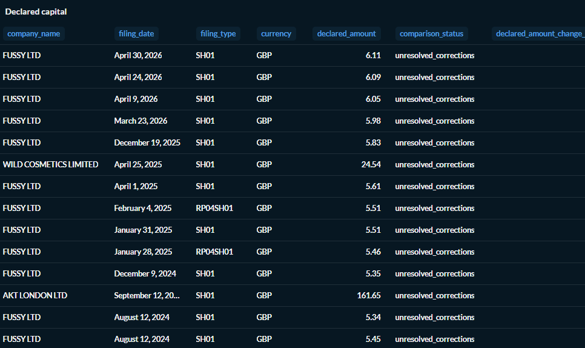

# Analytics marts

Five views turn Companies House records into practical questions about deadlines, governance, control, filings, and capital. Each includes a Metabase example.

**One row** describes each mart’s grain. See the [star schemas](../stars/STARS.md) for the underlying records.

[Obligations](#company-obligations) · [Governance](#monthly-governance) · [Control](#company-control) · [Filing activity](#monthly-filing-activity) · [Capital](#declared-capital-history)

## Model overview

*Select the diagram to enlarge it. For complete column definitions, follow the SQL links below.*

## Company obligations

> Which filing deadlines need follow-up?

Accounts and confirmation-statement deadlines form a follow-up queue across the four companies, helping prioritize what needs attention.

**One row:** A company’s obligation of a given type at an observation date.  
**SQL:** [`mart_company_obligations`](../../dbt/housing_project/models/gold/marts/mart_company_obligations.sql)

## Monthly governance

> How has each company’s board changed over time?

Board size alongside appointments and resignations helps reveal periods of stability or turnover.

**One row:** A company in a month.  
**SQL:** [`mart_governance_monthly`](../../dbt/housing_project/models/gold/marts/mart_governance_monthly.sql)

## Company control

> Who controls each company, and through which rights?

Review persons with significant control (PSCs), their ownership and voting rights, and whether their register entries remain active.

**One row:** A company-specific PSC register entry at an observation date.  
**SQL:** [`mart_company_control`](../../dbt/housing_project/models/gold/marts/mart_company_control.sql)

## Monthly filing activity

> When are companies filing more, and what are they filing?

Monthly counts reveal busy periods and quiet stretches. A category breakdown can help explain peaks in filing activity.

**One row:** A company, month, and filing category.  
**SQL:** [`mart_filing_activity_monthly`](../../dbt/housing_project/models/gold/marts/mart_filing_activity_monthly.sql)

## Declared capital history

> What capital has been declared, and which changes can we compare reliably?

Comparison checks flag corrections and ambiguities that prevent reliable comparisons between declarations.

**One row:** A company’s filing transaction in one currency.  
**SQL:** [`mart_declared_capital_history`](../../dbt/housing_project/models/gold/marts/mart_declared_capital_history.sql)

