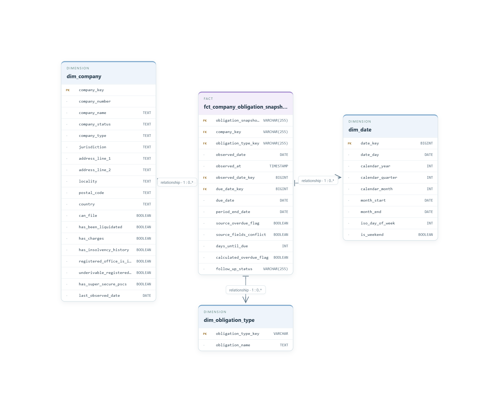
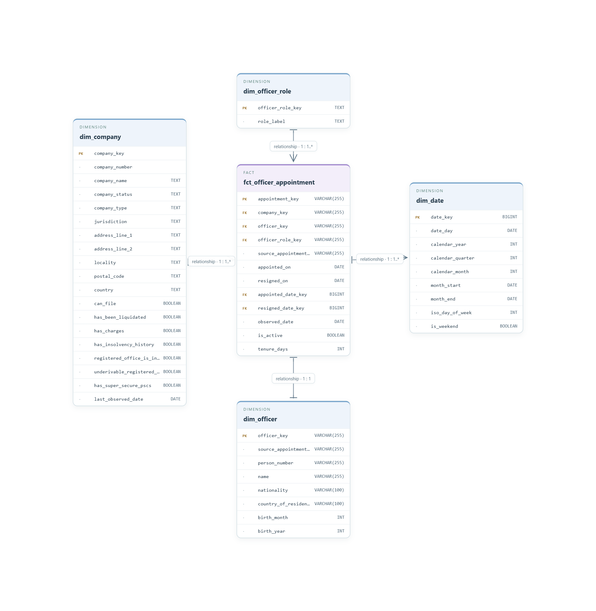
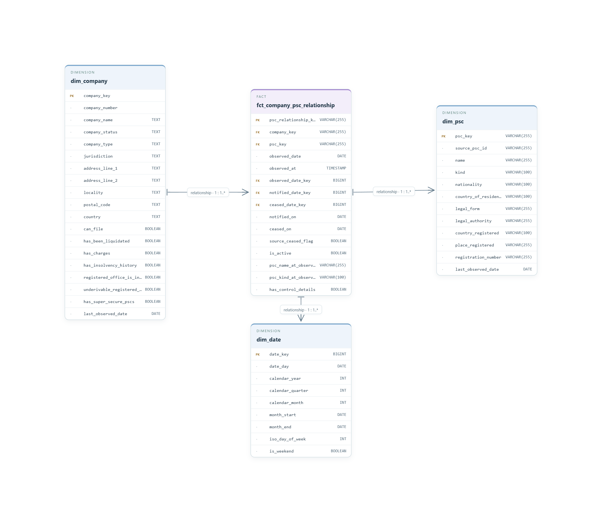
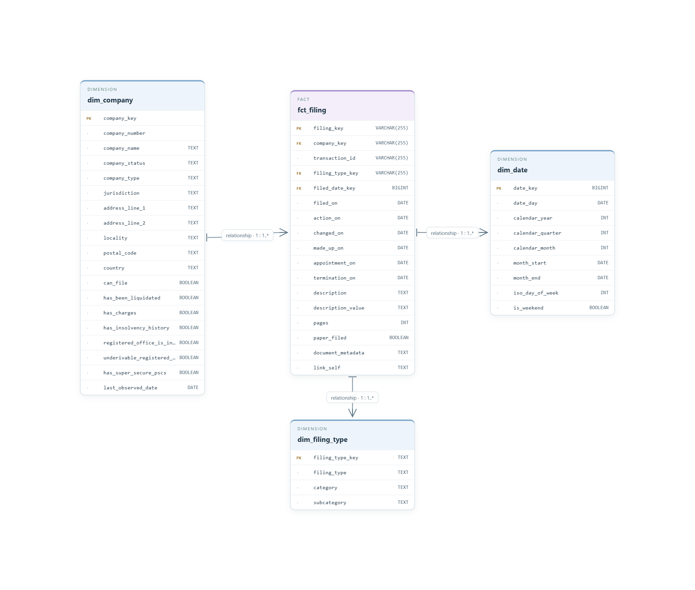
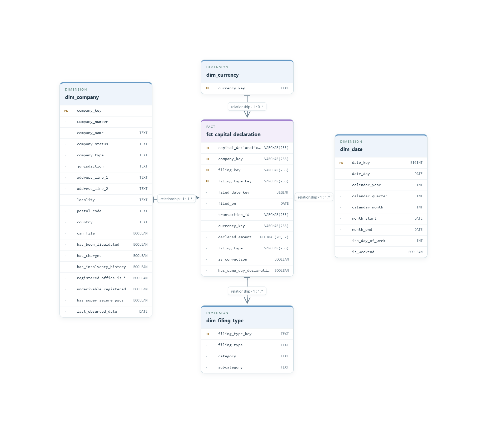

# Star schemas

These five schemas organize Companies House records around obligations, appointments, control, filings, and capital. They keep the detail behind the [analytics marts](../marts/MARTS.md), so each result can be traced back to the records behind it.

Each schema combines a fact table with context such as company, role, or date. 

[Obligations](#company-obligations) · [Appointments](#officer-appointments) · [Control](#company-control) · [Filings](#filing-events) · [Capital](#capital-declarations)

The diagrams are simplified overviews; the linked SQL models contain the complete definitions. Observation dates refer to dbt builds and do not necessarily mean fresh data was collected that day.

## Company obligations

> Which filing deadlines need attention?

This schema tracks accounts and confirmation-statement obligations, including due dates, days remaining, and follow-up status. It provides the detail needed to build a deadline queue for each company.

**One row:** A company’s obligation of a given type at an observation date.  
**Fact:** [`fct_company_obligation_snapshot`](../../dbt/housing_project/models/gold/facts/fct_company_obligation_snapshot.sql)

Company, obligation type, and date dimensions provide context. The date dimension serves two roles: when the obligation was observed and when it is due.

Use one observation date when counting obligations. The default `due_soon` window is 30 days.

## Officer appointments

> Who has held a role at each company, and for how long?

Appointment and resignation dates make it possible to follow board changes and calculate tenure. Company, officer, role, and date dimensions describe each appointment.

**One row:** One source appointment record.  
**Fact:** [`fct_officer_appointment`](../../dbt/housing_project/models/gold/facts/fct_officer_appointment.sql)

Officer identity is tied to the appointment in this implementation, giving a one-to-one relationship with `dim_officer`. Counts therefore represent appointments, not unique people across companies. Active status and ongoing tenure are evaluated at the observation date.

## Company control

> Who has significant control of a company, and what rights do they hold?

This schema records company-specific persons with significant control (PSC) entries. It supports analysis of active controllers and their reported ownership, voting, and appointment rights.

**One row:** A company-specific PSC register entry at an observation date.  
**Fact:** [`fct_company_psc_relationship`](../../dbt/housing_project/models/gold/facts/fct_company_psc_relationship.sql)

Company, PSC, and date dimensions provide context. Multiple rights are connected through `bridge_psc_control_nature` to `dim_control_nature`; this bridge is not shown below.

Filter to one observation date and count distinct relationships after joining rights. Ownership bands describe ranges, not exact percentages.

## Filing events

> What has each company filed, and when?

This schema keeps individual filings with their classification, descriptions, page counts, and document links. It supports both filing-volume analysis and investigation of a particular record.

**One row:** A filing transaction for a company.  
**Fact:** [`fct_filing`](../../dbt/housing_project/models/gold/facts/fct_filing.sql)

Company, filing type, and filing date dimensions support comparisons over time. The filing date can differ from the date of the underlying event; the fact retains those event dates where available.

## Capital declarations

> What capital amounts has each company declared?

This schema preserves each declaration with its currency, filing context, and correction flags. It provides a record of reported amounts and the foundation for the capital-history mart’s comparison checks.

**One row:** A company’s filing transaction in one currency.  
**Fact:** [`fct_capital_declaration`](../../dbt/housing_project/models/gold/facts/fct_capital_declaration.sql)

Dimensions describe the company, filing type, date, and currency. The additional `filing_key` link points to `fct_filing`, not a filing dimension; that relationship is not shown below.

Keep currencies separate and do not sum declarations across filings. Declared capital is not funding raised. Use the [capital-history mart](../marts/MARTS.md#declared-capital-history) to compare declarations where the model’s rules allow it.

